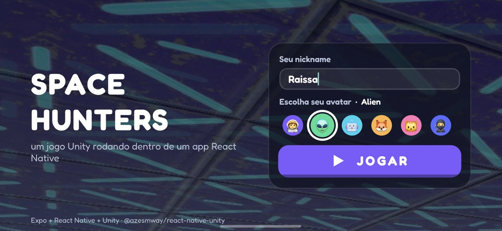
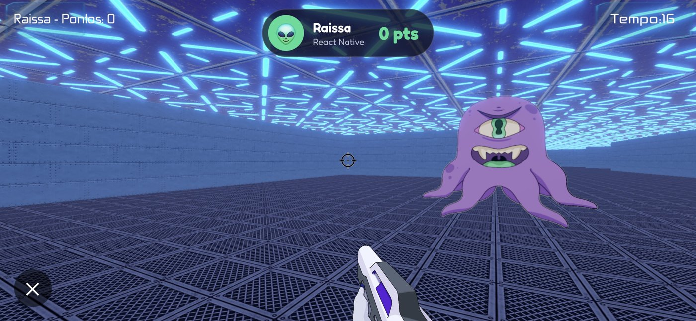
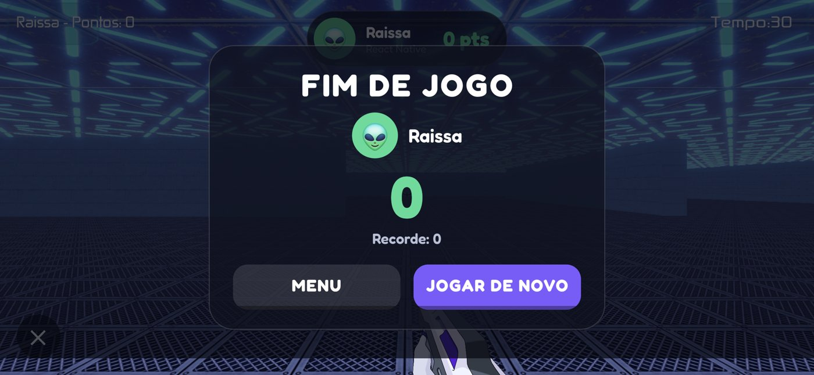

# Space Hunters: Unity dentro do React Native com Expo

Seminário da disciplina de **Desenvolvimento para Dispositivos Móveis** (ADS · IFSP Caraguatatuba · 2026).
Autora: **Raissa Patricio**

Um jogo feito na **Unity** rodando **dentro** de um app **React Native/Expo**, com a biblioteca [`@azesmway/react-native-unity`](https://github.com/azesmway/react-native-unity). O menu, o placar e a tela de fim de jogo são React Native; o jogo é Unity, no mesmo app.

| Menu (React Native) | Jogo (Unity + placar em React) | Fim de jogo (React) |
|---|---|---|
|  |  |  |

Slides: _(link do Canva em breve)_

## Baixar e jogar

O APK para Android está em [**Releases**](https://github.com/raissapatricio/space-hunters/releases). Ele roda em celulares Android 8 ou mais novos, de 64 bits (ARM64). Na instalação, o Android pede para permitir "instalar apps desconhecidos".

**Controles:** a metade esquerda da tela é o joystick para andar; arraste na metade direita para mirar e toque rápido para atirar. A partida dura 60 segundos.

## Como funciona

```
Jogo na Unity ──export Android──► unityLibrary ──Gradle──► <UnityView /> na tela React
```

1. A Unity exporta o jogo como **biblioteca Android** (recurso oficial *Unity as a Library*).
2. O `npx expo prebuild` gera a pasta `android/`, e o **config plugin** da biblioteca inclui a `unityLibrary` no Gradle.
3. A biblioteca fornece o componente `<UnityView />`, usado como qualquer outra `View`.
4. App e jogo trocam mensagens:
   - **React → Unity:** `postMessage('RNBridge', 'SetJogador', nome)`;
   - **Unity → React:** o jogo envia `{"tipo":"ponto"}` e o app recebe no `onUnityMessage`.

### Por que precisa de prebuild?
A Unity é **código nativo**, que precisa ser compilado dentro do app. O **Expo Go** já vem compilado e não aceita código nativo novo. Por isso usamos um **Development Build**: o `expo prebuild` gera a pasta `android/` a partir do `app.json` e dos config plugins (*Continuous Native Generation*).

## Tecnologias

| Peça | Versão |
|---|---|
| Expo SDK | 58 (Development Build) |
| React Native | 0.88 |
| Biblioteca | `@azesmway/react-native-unity` 1.1.1 |
| Unity | 6 · IL2CPP · ARM64 |
| Android | minSdk 26 |

## Como rodar

```powershell
npm install
powershell -ExecutionPolicy Bypass -File scripts\exportar-unity.ps1 -UnityProject C:\caminho\do\jogo
npx expo prebuild -p android --clean
npx expo run:android
```

Os scripts do jogo estão em `unity-scripts/`. O projeto completo da Unity e o export não estão no repositório, por causa do tamanho e dos assets de terceiros.

## Estrutura

```
app.json                  nome, orientação e plugins
src/app/                  telas: menu (index.tsx) e jogo (jogo.tsx)
src/components/           componentes do menu e do jogo
src/config/               textos, avatares, imagens e duração da partida
src/unity/JogoUnity.tsx   integração com a Unity
plugins/                  config plugin do Android
unity-scripts/            scripts C# do jogo e da integração (RNBridge.cs + Editor/)
```

## Créditos
- **Código:** Raissa Patricio.
- **Assets do jogo:** gratuitos, de terceiros (também aparecem nos fundos do menu e nos prints).
- **Biblioteca:** [`@azesmway/react-native-unity`](https://github.com/azesmway/react-native-unity) (MIT).
- **Fonte:** [Fredoka](https://fonts.google.com/specimen/Fredoka) (OFL).
- **Licença:** MIT para o código deste repositório; não vale para os assets de terceiros.
